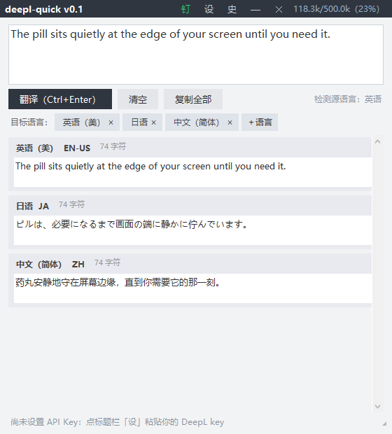

# deepl-quick

> 一枚贴在屏幕边缘的「译」胶囊 —— DeepL API 驱动的桌面翻译小窗：自动检测源语言、多语言一键复制、纯本地、零依赖。
> A tiny pill that sits quietly at the edge of your screen — a DeepL-powered translator widget for Windows. Pure tkinter, zero dependencies, fully local.

<p align="center">
  
</p>
<p align="center">
  平时缩成一枚胶囊：&nbsp;
  
</p>

当前版本：**v0.2** ・ License：[MIT](LICENSE)

[中文](#-中文) ・ [English](#english)

---

## 🇨🇳 中文

### 这是什么

`deepl-quick` 是一款 Windows 桌面翻译小窗：平时缩成一枚「译」胶囊贴在屏幕右缘，鼠标移上去即展开；粘贴或输入任意文本，DeepL 自动检测源语言，把译文同时翻成你勾选的几门常驻语言，逐语种一键复制。呼吸之间完成「看不懂 → 拿走译文」。

同门项目：[QuadTodo](https://github.com/geekkkk404/quad-todo)（四象限待办小窗）—— 同一套「单文件、零依赖、纯本地」的打法。

### 特性

- **贴边药丸常驻**：鼠标离开约 0.75s 自动折叠成 39×30 胶囊，悬停展开、静止不弹跳、拖动中不折叠；窗口位置与药丸位置均有记忆
- **开机自启（可选）**：设置弹窗勾选即写 HKCU Run 键（免管理员），登录后直接缩成贴边药丸；Windows 任务管理器「启动应用」可随时停用；自带单实例保护，不会叠出两枚药丸
- **自动检测源语言**：无需选择源语言，DeepL 返回检测结果并显示在界面上
- **常驻目标语言**：默认英/日/中，可从完整语言清单勾选（上限 8 个，保持界面干净）；清单支持在线刷新，DeepL 新增语言不用升级本工具
- **逐语种一键复制**：每张译文卡片独立复制；「复制全部」按【语言】前缀合并
- **省额度三件套**：翻译缓存（同文本同语言命中零消耗）、用量仪表（80%/95% 变色预警）、目标语懒加载
- **本地翻译历史**：可在设置中关闭或一键清空；双击历史条目回填原文
- **高质量模式**：可选 DeepL 下一代模型（`quality_optimized`），不额外消耗额度
- **纯本地、零依赖**：密钥、历史、缓存全部只存本机；Python 3.8+ 标准库即可运行（tkinter + urllib），空闲内存 ~30 MB

### 快速开始

1. **拿一把 DeepL API key**：在 [DeepL 官网](https://www.deepl.com/pro#api) 注册 Developer 计划（免费；新账号含 1,000,000 字符一次性额度；存量 API Free 订阅为 500,000 字符/月）。创建 key 后复制备用。
2. **运行**：双击 `deepl_quick.pyw`（需已安装 Python 3.8+，无需 pip 安装任何东西）。
3. **贴 key**：首次启动点标题栏「设」，粘贴 key，保存。key 只会写进脚本同目录的 `.deepl-key` 文件。
4. 鼠标碰到药丸展开，输入文本，`Ctrl+Enter` 翻译。

### 使用

| 操作 | 方式 |
|------|------|
| 翻译 | `Ctrl+Enter` 或点「翻译」 |
| 复制某门语言 | 该卡片右上角「复制」 |
| 复制全部译文 | 「复制全部」 |
| 增删常驻语言 | 语言条「＋语言」；chip 上「×」移除 |
| 历史 | 标题栏「史」，双击条目回填原文 |
| 设置（key / 高质量模式 / 历史开关 / host / 开机自启） | 标题栏「设」 |
| 折叠 / 展开 | 标题栏「—」；或鼠标离开 / 悬停自动 |
| 拖动 / 调整大小 | 拖标题栏；右下角「◢」 |
| 置顶开关 | 标题栏「钉」（绿=开） |

### 隐私

- **API key 只存本机** `.deepl-key`（已在 `.gitignore`，永不入库、永不随包分发）
- **无遥测**：唯一的网络请求是直连 DeepL 官方 API（免费档 `api-free.deepl.com`）
- **历史与缓存纯本地**（`history.json` / `cache.json`），可在设置里关闭、清空
- 翻译内容只会发给 DeepL——这是它的工作方式

### 额度说明

计费按**源文本字符数**：同一段文本翻 3 门语言 = 3 次请求 = 3 倍字符。本工具为此内置：缓存优先（命中零消耗）、默认手动触发（防抖自动翻可开）、每次翻译前显示预估消耗、额度耗尽（HTTP 456）明确提示不再重试。

### 自检

```bash
python deepl_quick.pyw --smoke
```

38 项自检全部离线运行（数据文件重定向到临时目录、注册表读写走 scratch 键，不发任何网络请求）。

### License

[MIT](LICENSE)

---

## English

### What is this

`deepl-quick` is a tiny translator widget for Windows: it normally shrinks into a single-character 「译」pill docked at the right edge of your screen. Hover to expand, paste any text, and DeepL auto-detects the source language while translating into your pinned target languages at once — each result one click away from your clipboard.

Sibling project: [QuadTodo](https://github.com/geekkkk404/quad-todo) — same single-file, zero-dependency, fully-local philosophy.

### Features

- **Edge pill, always resident** — auto-collapses (~0.75s) to a 39×30 pill when the mouse leaves; hover to expand; no bounce while idle, no collapse while dragging; both window and pill positions are remembered
- **Optional auto-start** — tick it in settings to register an HKCU Run key (no admin needed); the pill docks itself at login; disable anytime from Task Manager → Startup apps; single-instance guard included
- **Auto source detection** — no language picking; DeepL returns the detected language and the UI shows it
- **Pinned target languages** — EN/JA/ZH by default, pick from the full language list (up to 8 to keep the UI clean); the list can be refreshed online, so new DeepL languages appear without upgrading this tool
- **One-click copy per language** — each card copies independently; "copy all" merges with `【Language】` prefixes
- **Quota-friendly trio** — translation cache (cache hits cost nothing), usage badge (amber ≥80%, orange ≥95%), per-request cost estimate before translating
- **Local history** — toggleable and clearable in settings; double-click an entry to refill the source text
- **High-quality mode** — optionally uses DeepL's next-gen model (`quality_optimized`) at no extra quota cost
- **Fully local, zero dependencies** — key, history and cache never leave your machine; runs on the Python 3.8+ standard library only (tkinter + urllib); ~30 MB idle memory

### Getting started

1. **Get a DeepL API key**: sign up for the free Developer plan at [deepl.com/pro#api](https://www.deepl.com/pro#api) (new accounts include a one-time 1,000,000-character quota; legacy API Free subscriptions get 500,000 characters per month). Create and copy a key.
2. **Run**: double-click `deepl_quick.pyw` (requires Python 3.8+; nothing to pip-install).
3. **Paste the key**: click 「设」 in the title bar on first launch, paste, save. The key is stored only in the local `.deepl-key` file next to the script.
4. Hover the pill to expand, type, press `Ctrl+Enter`.

### Privacy

- **The API key stays on your machine** (`.deepl-key`, git-ignored, never committed or shipped)
- **No telemetry** — the only network traffic is your own translation requests to DeepL's official API (free tier: `api-free.deepl.com`)
- **History and cache are local files** (`history.json` / `cache.json`), toggleable and clearable in settings
- Your text goes to DeepL — that's the job

### Quota notes

Usage is counted in **source characters**: translating one text into 3 languages = 3 requests = 3× characters. This tool therefore ships with: cache-first requests (hits cost nothing), manual trigger by default (debounced auto-translate is optional), a per-request cost estimate, and a clear stop on quota exhaustion (HTTP 456).

### Self-test

```bash
python deepl_quick.pyw --smoke
```

38 offline checks (data files go to a temp directory, registry writes go to a scratch key; no network requests).

### License

[MIT](LICENSE)
